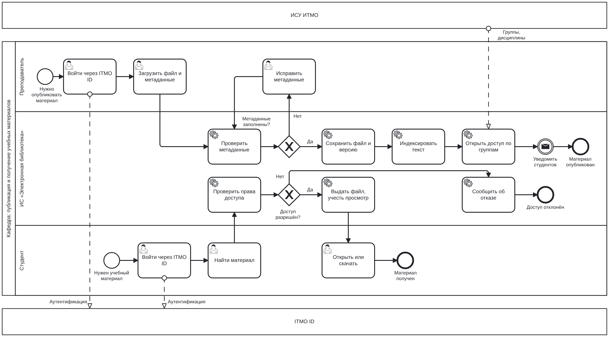

# Лабораторная работа. Концепция информационной системы «Электронная библиотека кафедры»

**Дисциплина:** Проектирование информационных систем\
**Вариант № 6:** Электронная библиотека кафедры\
**Стадия жизненного цикла:** 2 «Разработка концепции АС» по ГОСТ Р 59793-2021

## Состав команды и распределение ролей

| Участник        | Роли на стадии концепции                                              | Разделы отчёта |
| :-------------- | :-------------------------------------------------------------------- | :------------- |
| Студент 1 (Северюхин Андрей) | Бизнес-аналитик, архитектор, представитель пользователей              | 1, 2, 3, 4     |
| Студент 2 (Кохан Всеволод) | Руководитель проекта, системный аналитик, специалист по ИБ            | 5, 6, 7, 8     |
| Заказчик        | Заведующий кафедрой: утверждает критерии, веса и выбранный вариант    | —              |

Раздел 9 «Выводы» подготовлен совместно.

Внешнего заказчика у команды нет, поэтому роль заведующего кафедрой имитировалась с помощью большой языковой модели (БЯМ). Модели были переданы только критерии и веса, без вариантов и их оценок. Протокол согласования приведён в разделе 4.2 и в приложении А.

## 1. Характеристика объекта автоматизации и требования пользователя

### 1.1. Общая характеристика предметной области

Электронная библиотека кафедры предназначена для централизованного хранения, систематизации и предоставления учебно-методических материалов студентам и преподавателям кафедры.

Объект автоматизации условный: одна кафедра Университета ИТМО. Ограничения преподавателем не заданы, поэтому команда приняла их как допущения. Сведения о сервисах ИТМО (ITMO ID, ИСУ, библиотека ИТМО) взяты из открытых источников.

| Параметр                 | Значение                                                                                      |
| :----------------------- | :-------------------------------------------------------------------------------------------- |
| Пользователи             | около 600 студентов, 40 преподавателей, 1 сотрудник, ведущий библиотеку                       |
| Пиковая нагрузка         | до 100 одновременно работающих пользователей                                                  |
| Фонд                     | электронные методические указания, пособия, лабораторные работы, примеры ВКР; бумажный фонд около 1500 книг |
| Бюджет создания          | не более 600 000 руб. (жёсткое ограничение)                                                   |
| Эксплуатация             | не более 150 000 руб. в год (жёсткое ограничение)                                             |
| Срок внедрения           | не более 5 месяцев (жёсткое ограничение по решению заказчика, см. раздел 4.2)                 |
| Размещение данных        | только на территории РФ, соответствие 152-ФЗ (жёсткое ограничение)                            |

### 1.2. Описание текущего процесса (AS-IS)

В текущей модели материалы передаются через электронную почту, мессенджеры, личные папки преподавателей и другие хранилища. Студенту приходится самостоятельно выяснять, где находится нужный файл и какая его версия является актуальной.

### 1.3. Участники процесса

| Участник                       | Функции                                                                               |
| :----------------------------- | :------------------------------------------------------------------------------------ |
| Студент                        | Поиск материалов, просмотр и скачивание доступных документов, получение бумажных книг |
| Преподаватель                  | Подготовка, загрузка и обновление материалов, указание литературы в РПД               |
| Библиотекарь                   | Учёт бумажных книг, контроль выдачи и возврата, помощь пользователям                  |
| Заведующий кафедрой            | Контроль обеспеченности дисциплин учебной литературой                                 |
| Администратор                  | Управление доступом, настройка системы, контроль её работоспособности                 |
| Системы ИТМО (ITMO ID, ИСУ)    | Единый вход, справочники дисциплин, групп и сотрудников                               |

### 1.4. Проблемы текущего состояния и их последствия

| №  | Проблема                                                     | Последствие                                         |
| -: | :----------------------------------------------------------- | :-------------------------------------------------- |
| П1 | Материалы хранятся в разных местах (почта, чаты, личные диски) | Увеличивается время поиска                        |
| П2 | Нет единого каталога и поиска, в том числе по тексту         | Пользователи не знают обо всех доступных материалах |
| П3 | Версии файлов не контролируются                              | Студенты работают с устаревшими документами         |
| П4 | Доступ регулируется вручную, материалы пересылаются без ограничений | Нагрузка на преподавателей, риск нарушения авторских прав |
| П5 | Учёт бумажных книг ведётся в бумажном журнале                | Ошибки в сведениях о выдаче, потеря книг            |
| П6 | Нет статистики использования                                 | Сложно оценивать востребованность материалов        |
| П7 | Нет связи материалов с дисциплинами и РПД                    | Обеспеченность дисциплин литературой проверяется вручную |

### 1.5. Требования пользователя

Приоритеты: Must — обязательно, Should — желательно, Could — при возможности. Варианты, которые не выполняют требования Must, исключаются из выбора.

| №   | Группа            | Требование                                                                    | Приоритет | Проблема |
| -:  | :---------------- | :---------------------------------------------------------------------------- | :-------- | :------- |
| Т1  | Функциональные    | Каталог с описанием материалов (автор, дисциплина, год, тип)                  | Must      | П1, П2   |
| Т2  | Функциональные    | Поиск по атрибутам и по тексту материалов                                     | Must      | П2       |
| Т3  | Функциональные    | Загрузка и версионирование материалов преподавателями                         | Must      | П3       |
| Т4  | Функциональные    | Доступ к материалам по принадлежности студента к дисциплине или группе        | Must      | П4       |
| Т5  | Функциональные    | Сверка с литературой из РПД, отчёт об обеспеченности дисциплин                | Should    | П7       |
| Т6  | Функциональные    | Учёт выдачи и возврата бумажных книг                                          | Should    | П5       |
| Т7  | Функциональные    | Статистика использования материалов                                           | Should    | П6       |
| Т8  | Функциональные    | Пополнение материалов силами кафедры без участия разработчика                 | Should    | П1       |
| Т9  | Функциональные    | Уведомления о новых материалах                                                | Could     | —        |
| Т10 | Интеграция        | Вход через единую учётную запись ITMO ID                                      | Must      | П4       |
| Т11 | Интеграция        | Получение справочников из ИСУ (дисциплины, группы, сотрудники) без ручного ведения | Must | П4, П7   |
| Т12 | Интеграция        | Ссылки на издания библиотеки ИТМО вместо дублирования                         | Should    | П1, П3   |
| Т13 | Нефункциональные  | Время отклика не более 2 с при 100 одновременных пользователях                | Must      | —        |
| Т14 | Нефункциональные  | Работа с мобильных устройств                                                  | Should    | —        |
| Т15 | Ограничения       | Хранение данных на территории РФ, соответствие 152-ФЗ                         | Must      | —        |
| Т16 | Ограничения       | Соблюдение авторских прав на публикуемые материалы                            | Must      | П4       |
| Т17 | Ограничения       | Укладка в бюджет создания и эксплуатации                                      | Must      | —        |
| Т18 | Ограничения       | Срок внедрения не более 5 месяцев                                             | Must      | —        |

Принцип интеграции: ИСУ является главным источником справочников. Система только читает из ИСУ данные о дисциплинах, группах и сотрудниках и ничего в ИСУ не записывает.

## 2. Аналитический обзор аналогов и готовых решений

### 2.1. Существующие сервисы ИТМО

- Библиотека ИТМО: личный кабинет читателя с входом через ITMO ID, заказ книг.
- books.ifmo.ru: каталог учебных изданий преподавателей ИТМО.
- Яндекс 360: корпоративный аккаунт, доступный студентам ИТМО.
- Шаблон РПД ИТМО требует указывать издания из электронных библиотечных систем, доступных в университете.

### 2.2. Сравнение аналогов по единым критериям

| Критерий             | ИРБИС64+                                    | МАРК-SQL                                | DSpace + Koha                                      | ЭБС (Лань, IPRbooks)                  | Сервисы ИТМО                         |
| :------------------- | :------------------------------------------ | :-------------------------------------- | :------------------------------------------------- | :------------------------------------ | :----------------------------------- |
| Происхождение        | Отечественное                               | Отечественное                           | Открытый код                                       | Отечественное                         | Собственные сервисы ИТМО             |
| Функции              | Электронная библиотека с полными текстами, книговыдача | Каталог, управление фондом, веб-модуль | Репозиторий, полнотекстовый поиск, роли; бумажный фонд через Koha | Подписка на издания издательств | Каталог библиотеки, заказ книг, издания преподавателей |
| Лицензирование       | Платная лицензия                            | Платная лицензия                        | Бесплатное ПО                                      | Годовая подписка                      | Уже используются                     |
| Стоимость            | около 500 000 руб., если ИРБИС64 не куплен  | по запросу                              | ПО бесплатно, оплачиваются сервер и администрирование | подписка вуза                      | для кафедры бесплатно                |
| Вход через ITMO ID   | требует доработки                           | требует доработки                       | поддерживается OpenID Connect (с версии 7.2)       | собственные логины или вход по IP     | есть                                 |
| Справочники ИСУ      | импорт, нужна доработка                     | импорт, нужна доработка                 | нужен собственный коннектор                        | нет                                   | есть                                 |
| Размещение данных    | свой сервер в РФ                            | свой сервер в РФ                        | свой сервер в РФ                                   | у поставщика в РФ                     | инфраструктура ИТМО                  |
| Главный недостаток   | рассчитана на библиотеку всего вуза         | то же                                   | две системы, сложный интерфейс, нужен администратор | не хранит собственные материалы кафедры | кафедра не управляет развитием    |

### 2.3. Выводы обзора

1. ИРБИС64+ и МАРК-SQL рассчитаны на библиотеку всего вуза и избыточны для кафедры.
2. ЭБС решают другую задачу: доступ к изданиям издательств, а не к внутренним материалам кафедры.
3. DSpace бесплатен, поддерживает полнотекстовый поиск и OpenID Connect, поэтому подходит как готовое ядро.
4. Ни одно решение не поддерживает связь с РПД без доработки.
5. Сервисы ИТМО лучше всего интегрированы, но кафедра не управляет их развитием и сроками.

Наличие у решения нужной функции само по себе не означает, что оно подходит для проекта. До выбора необходимо проверить условия лицензирования, возможности интеграции, стоимость сопровождения и соответствие требованиям по обработке персональных данных.

### 2.4. Допущения, требующие проверки

- Протокол ITMO ID публично не описан. Предполагается стандартный протокол (OpenID Connect или SAML), уточняется у ИТ-службы ИТМО.
- Публичный API ИСУ не найден. Доступ к справочникам требует согласования с ИТ-службой ИТМО.
- Стоимость МАРК-SQL предоставляется по запросу.

## 3. Альтернативные варианты концепции ИС

### 3.1. Допущения для расчёта ресурсов

Все суммы являются **предварительными оценками для сравнения альтернатив**, а не подтверждёнными коммерческими предложениями.

- Стоимость труда: 120 000 руб. за человеко-месяц с налогами (сотрудник или аспирант ИТМО по договору).
- Виртуальный сервер в российском облаке или ЦОД ИТМО (4 ядра, 8 ГБ памяти, 200 ГБ диска): около 80 000–90 000 руб. в год.
- Стоимость создания = трудоёмкость × 120 000 руб. + сервер и стенд на период работ.

### 3.2. Описание вариантов

**Вариант A. Организационный («нулевой»).** Материалы размещаются в папках Яндекс 360 ИТМО, сведения о них ведутся в таблице, выкладка и выдача книг регулируются регламентом. Новая ИС не создаётся. Вариант служит точкой отсчёта: показывает, можно ли решить задачу без системы.

**Вариант B. Настройка готовой платформы.** DSpace для электронного фонда и Koha для бумажного фонда на сервере кафедры, собственные коннекторы к ITMO ID и ИСУ. По сути это комбинированный вариант: готовое ядро и свои модули интеграции.

**Вариант C. Расширение существующих сервисов ИТМО.** Кафедра заказывает у ИТ-службы и библиотеки ИТМО раздел кафедры в существующих университетских системах.

**Вариант D. Разработка отдельного веб-приложения.** Специализированная система с файловым хранилищем и полнотекстовым поиском, изначально спроектированная под интеграцию с ITMO ID и ИСУ.

| Параметр                          | Вариант A                                         | Вариант B                                               | Вариант C                                          | Вариант D                                                   |
| :-------------------------------- | :------------------------------------------------ | :------------------------------------------------------ | :------------------------------------------------- | :---------------------------------------------------------- |
| Идея решения                      | Папки, таблица-каталог, регламент                 | DSpace и Koha, свои коннекторы к ИТМО                   | Раздел кафедры в системах ИТМО                     | Собственное веб-приложение кафедры                          |
| Автоматизируемые функции          | Хранение; каталог и журнал выдачи вручную         | Каталог, загрузка, версии, полнотекстовый поиск, роли, книговыдача | Каталог и полные тексты, вход и права из ИТМО | Все требования: каталог, поиск, версии, права по группам ИСУ, книговыдача, сверка с РПД, статистика |
| Архитектура и технологии          | Облачный диск и электронная таблица               | Java, Angular, Solr, PostgreSQL; две системы и коннектор | Определяется ИТ-службой ИТМО                      | ASP.NET Core, PostgreSQL, файловое хранилище, полнотекстовый поиск, модуль интеграции |
| Команда и трудоёмкость, чел.-мес. | 0,5 (библиотекарь, методист)                      | 3 (администратор, разработчик коннекторов)              | 2–3 у ИТ-службы ИТМО, 0,5 у кафедры                | 4,5 (аналитик 0,5, два разработчика, тестировщик)            |
| Стоимость создания, руб.          | 60 000                                            | 400 000                                                 | 300 000 (условно, внутренний заказ)                | 570 000                                                     |
| Эксплуатация в год, руб.          | 120 000 (время сотрудника на ручную работу)       | 150 000 (сервер, администрирование)                     | 30 000                                             | 150 000 (сервер, поддержка 0,5 чел.-мес.)                    |
| Срок внедрения                    | 1 месяц                                           | 3–4 месяца                                              | 5–8 месяцев, зависит от очереди ИТ-службы          | 5 месяцев                                                   |
| Достоинства                       | Быстро, дёшево, понятно всем                      | Готовые зрелые компоненты, OpenID Connect из коробки    | Лучшая интеграция, минимальные затраты на эксплуатацию | Точное соответствие требованиям, единый интерфейс, кафедра управляет развитием |
| Недостатки                        | Нет поиска по тексту и автоматических прав, всё держится на дисциплине людей | Две системы, сложный интерфейс, нет связи с РПД | Зависимость от владельцев сервисов, неопределённый срок | Наибольшая стоимость, бюджет на пределе, сопровождение на кафедре |

Вариант D укладывается в бюджет создания, но находится близко к его верхней границе. Для вариантов B и D расходы на эксплуатацию достигают годового лимита.

## 4. Сравнение альтернатив и выбор решения

### 4.1. Метод оценки

Используется метод взвешенной оценки. Каждый вариант оценивается по шкале от 1 до 5, где 1 — низкая оценка, а 5 — высокая. Итоговая оценка:

$$
S_i = \sum_{j=1}^{m} w_j s_{ij}, \qquad \sum_{j=1}^{m} w_j = 1,
$$

где $S_i$ — итоговая оценка варианта $i$, $w_j$ — вес критерия $j$, $s_{ij}$ — оценка варианта $i$ по критерию $j$, $m$ — количество критериев.

### 4.2. Согласование критериев и весов с заказчиком

Команда предложила критерии и веса до выставления оценок. Заказчику (заведующему кафедрой) варианты и оценки не показывались. Полный текст ответа приведён в приложении А.

| Критерий                                | Предложено командой | Утверждено заказчиком | Обоснование изменения                                        |
| :-------------------------------------- | ------------------: | --------------------: | :----------------------------------------------------------- |
| Соответствие функциональным требованиям |                0,25 |              **0,20** | Базовые требования просты, высокий вес поощряет избыточный функционал |
| Интеграция с ИТМО                       |                0,20 |              **0,15** | Часть интеграций зависит не от кафедры, а от университета    |
| Совокупная стоимость владения за 3 года |                0,15 |              **0,20** | У кафедры нет резерва на перерасход                          |
| Срок внедрения                          |                0,10 |                  0,10 | Без изменений                                                |
| Безопасность и персональные данные      |                0,10 |                  0,10 | Без изменений                                                |
| Независимость и контроль над системой   |                0,10 |                  0,10 | Без изменений                                                |
| Удобство пользователей                  |                0,10 |              **0,15** | Ключевой фактор: иначе пользователи вернутся к мессенджерам  |
| **Итого**                               |            **1,00** |              **1,00** |                                                              |

Дополнительные условия заказчика:

1. Бюджет, срок 5 месяцев и соответствие 152-ФЗ являются жёсткими фильтрами: вариант, не прошедший фильтр, снимается независимо от баллов.
2. Критерий «Интеграция с ITMO» делится на ITMO ID (70 % веса критерия) и остальные интеграции: ИСУ, РПД, библиотека (30 %).
3. Пополнение материалов силами кафедры учитывается внутри критерия функциональных требований (требование Т8).

Ответ на замечание заказчика об оцифровке 1500 книг: оцифровка бумажного фонда не предусмотрена, так как сканирование изданных книг без согласия правообладателей нарушает авторские права (Т16). Бумажный фонд только каталогизируется для учёта выдачи; ввод карточек выполняет сотрудник кафедры в рамках своих обязанностей.

Ответ на требование подтверждать оценки проверяемыми данными: на стадии концепции оценки экспертные. Проверяемые показатели (тестирование удобства, время поиска, время отклика) перенесены в раздел 8 и будут подтверждены при приёмке.

### 4.3. Совокупная стоимость владения

$$
TCO = C_{\text{созд}} + \sum_{t=1}^{3} C_{\text{экспл},t}
$$

Для предварительного сравнения ежегодные эксплуатационные расходы приняты неизменными.

| Вариант | Расчёт                | TCO за 3 года, руб. | Оценка |
| :------ | :-------------------- | ------------------: | -----: |
| A       | 60 000 + 3 × 120 000  |             420 000 |      5 |
| B       | 400 000 + 3 × 150 000 |             850 000 |      3 |
| C       | 300 000 + 3 × 30 000  |             390 000 |      5 |
| D       | 570 000 + 3 × 150 000 |           1 020 000 |      2 |

Шкала оценки TCO: до 500 000 руб. — 5, от 500 000 до 800 000 — 4, от 800 000 до 1 000 000 — 3, более 1 000 000 — 2.

### 4.4. Матрица оценок

Оценка интеграции рассчитана по условию заказчика: $0{,}7 \cdot s_{\text{ITMO ID}} + 0{,}3 \cdot s_{\text{прочие}}$ с округлением до целого.

| Вариант | ITMO ID | ИСУ, РПД, библиотека | Итог по интеграции |
| :------ | ------: | -------------------: | -----------------: |
| A       |       1 |                    1 |          1,0 → 1   |
| B       |       4 |                    1 |          3,1 → 3   |
| C       |       4 |                    4 |          4,0 → 4   |
| D       |       4 |                    4 |          4,0 → 4   |

| Критерий                           |  Вес |  A |  B |  C |  D |
| :--------------------------------- | ---: | -: | -: | -: | -: |
| Функциональные требования          | 0,20 |  2 |  3 |  4 |  5 |
| Интеграция с ITMO                  | 0,15 |  1 |  3 |  4 |  4 |
| TCO за 3 года                      | 0,20 |  5 |  3 |  5 |  2 |
| Срок внедрения                     | 0,10 |  5 |  3 |  2 |  3 |
| Безопасность и персональные данные | 0,10 |  2 |  3 |  2 |  4 |
| Независимость и контроль           | 0,10 |  2 |  3 |  3 |  4 |
| Удобство пользователей             | 0,15 |  2 |  4 |  5 |  5 |
| **Итог $S_i$**                     | **1,00** | **2,75** | **3,15** | **3,85** | **3,85** |

Пояснения к спорным оценкам:

- Безопасность у C оценена на 2: персональные данные и материалы кафедры обрабатываются в чужой системе, кафедра не может проверить меры защиты и повлиять на правила доступа к своим материалам.
- Интеграция у D оценена на 4, а не на 5: технически D может реализовать всё, но доступ к ITMO ID и ИСУ ещё нужно получить.
- Удобство у B оценено на 4, а не на 5: интерфейс DSpace рассчитан на библиотекарей, а не на студентов.

Оценки являются экспертными и предварительными. Их следует уточнить после проверки возможностей платформ, условий интеграции и фактической стоимости работ.

### 4.5. Расчёт итоговых оценок

$$
\begin{aligned}
S_A &= 0{,}20 \cdot 2 + 0{,}15 \cdot 1 + 0{,}20 \cdot 5 + 0{,}10 \cdot 5 + 0{,}10 \cdot 2 + 0{,}10 \cdot 2 + 0{,}15 \cdot 2 = 2{,}75, \\
S_B &= 0{,}20 \cdot 3 + 0{,}15 \cdot 3 + 0{,}20 \cdot 3 + 0{,}10 \cdot 3 + 0{,}10 \cdot 3 + 0{,}10 \cdot 3 + 0{,}15 \cdot 4 = 3{,}15, \\
S_C &= 0{,}20 \cdot 4 + 0{,}15 \cdot 4 + 0{,}20 \cdot 5 + 0{,}10 \cdot 2 + 0{,}10 \cdot 2 + 0{,}10 \cdot 3 + 0{,}15 \cdot 5 = 3{,}85, \\
S_D &= 0{,}20 \cdot 5 + 0{,}15 \cdot 4 + 0{,}20 \cdot 2 + 0{,}10 \cdot 3 + 0{,}10 \cdot 4 + 0{,}10 \cdot 4 + 0{,}15 \cdot 5 = 3{,}85.
\end{aligned}
$$

### 4.6. Проверка жёстких ограничений

По условию заказчика варианты сначала проверяются фильтрами, и только прошедшие фильтр сравниваются по баллам.

| Вариант | Бюджет 600 000 + 150 000 в год | Срок не более 5 месяцев | 152-ФЗ | Требования Must          | Допущен к выбору |
| :------ | :----------------------------- | :---------------------- | :----- | :----------------------- | :--------------- |
| A       | да                             | да                      | да     | нет (Т2, Т4, Т11)        | **нет**          |
| B       | да                             | да                      | да     | да                       | да               |
| C       | да                             | **нет (5–8 месяцев)**   | да     | условно                  | **нет**          |
| D       | да, на пределе                 | да, на пределе          | да     | да                       | да               |

Варианты C и D набрали одинаковую оценку 3,85, но вариант C не проходит фильтр по сроку внедрения. Реальный выбор делается между B и D, и вариант D выигрывает с разрывом 0,70 балла.

### 4.7. Проверка устойчивости выбора

Самые весомые критерии — функциональные требования и TCO (по 0,20) — поочерёдно изменяются на ±0,05, разница переносится на другой критерий.

| Сценарий                                   |    A |    B | C (справочно) |    D | Лидер среди допущенных |
| :----------------------------------------- | ---: | ---: | ------------: | ---: | :--------------------- |
| Базовый                                    | 2,75 | 3,15 |          3,85 | 3,85 | D                      |
| Функциональность 0,25, TCO 0,15            | 2,60 | 3,15 |          3,80 | 4,00 | D                      |
| Функциональность 0,15, TCO 0,25            | 2,90 | 3,15 |          3,90 | 3,70 | D                      |
| Функциональность 0,25, удобство 0,10       | 2,75 | 3,10 |          3,80 | 3,85 | D                      |
| Функциональность 0,15, удобство 0,20       | 2,75 | 3,20 |          3,90 | 3,85 | D                      |
| TCO 0,25, удобство 0,10                    | 2,90 | 3,10 |          3,85 | 3,70 | D                      |
| TCO 0,15, удобство 0,20                    | 2,60 | 3,20 |          3,85 | 4,00 | D                      |

Выводы:

- Среди допущенных вариантов выбор D устойчив: во всех сценариях D опережает B не менее чем на 0,55 балла.
- Без учёта фильтров выбор между C и D неустойчив: при росте веса TCO лидером становится C. Поэтому если ИТ-служба ИТМО письменно подтвердит срок внедрения варианта C не более 5 месяцев, решение необходимо пересмотреть.

### 4.8. Матрица соответствия «требование × вариант»

Обозначения: да — выполняет, частично — выполняет частично или требует подтверждения, нет — не выполняет.

| №   | Требование                        | Приоритет | A         | B         | C         | D    |
| :-- | :-------------------------------- | :-------- | :-------- | :-------- | :-------- | :--- |
| Т1  | Каталог                           | Must      | частично  | да        | да        | да   |
| Т2  | Поиск по тексту                   | Must      | нет       | да        | частично  | да   |
| Т3  | Версионирование                   | Must      | частично  | да        | частично  | да   |
| Т4  | Доступ по дисциплине или группе   | Must      | нет       | да        | да        | да   |
| Т10 | Вход через ITMO ID                | Must      | частично  | да        | да        | да   |
| Т11 | Справочники из ИСУ                | Must      | нет       | да        | да        | да   |
| Т13 | Отклик не более 2 с               | Must      | да        | да        | да        | да   |
| Т15 | Данные в РФ, 152-ФЗ               | Must      | да        | да        | да        | да   |
| Т16 | Авторские права                   | Must      | частично  | да        | да        | да   |
| Т17 | Бюджет                            | Must      | да        | да        | да        | да   |
| Т18 | Срок не более 5 месяцев           | Must      | да        | да        | нет       | да   |
| Т5  | Сверка с РПД                      | Should    | нет       | нет       | частично  | да   |
| Т6  | Учёт бумажных книг                | Should    | частично  | да        | нет       | да   |
| Т7  | Статистика                        | Should    | нет       | да        | частично  | да   |
| Т8  | Пополнение силами кафедры         | Should    | да        | да        | нет       | да   |
| Т12 | Ссылки на библиотеку ИТМО         | Should    | частично  | частично  | да        | да   |
| Т14 | Работа с мобильных устройств      | Should    | частично  | частично  | да        | да   |

Выводы по матрице:

- Вариант A не выполняет три требования Must и не может быть выбран. Он показывает, что одних организационных мер недостаточно.
- Вариант C не выполняет требование к сроку и зависит от решений ИТ-службы ИТМО.
- Вариант D — единственный, который выполняет все требования Must и Should.

### 4.9. Решение

**Выбран вариант D — разработка отдельного веб-приложения.** Он проходит все жёсткие ограничения, выполняет все требования Must и Should и устойчиво опережает вариант B. Вариант C сохраняется как резервный: его следует пересмотреть, если ИТ-служба ИТМО подтвердит срок внедрения до 5 месяцев.

## 5. Целевая модель процесса TO-BE

### 5.1. Описание целевого процесса

Преподаватель входит в систему через ITMO ID, загружает файл и заполняет метаданные: название, дисциплину, тип материала. Система проверяет обязательные поля. Если они не заполнены, преподаватель исправляет метаданные. Если проверка пройдена, система сохраняет файл и новую версию (предыдущая версия уходит в архив и скрывается от студентов), индексирует текст и открывает доступ группам дисциплины по данным ИСУ, после чего уведомляет студентов.

Студент входит через ITMO ID и ищет материал в каталоге или полнотекстовым поиском. Система проверяет, относится ли студент к группе, изучающей дисциплину. Если доступ разрешён, система выдаёт файл и фиксирует просмотр в статистике. Если нет, система сообщает об отказе.

### 5.2. BPMN-диаграмма целевого процесса

Диаграмма выполнена в нотации BPMN 2.0. 

Пул «Кафедра» разделён на дорожки преподавателя, системы и студента. Внешние системы ИТМО (ИСУ и ITMO ID) показаны свёрнутыми пулами и связаны с процессом потоками сообщений. Процесс имеет два стартовых события: публикация материала и запрос материала студентом.

*Рисунок 5.1 — BPMN-диаграмма целевого процесса публикации и получения учебно-методических материалов.*

### 5.3. Границы автоматизации

| Операция                                   | Способ выполнения                                   |
| :----------------------------------------- | :-------------------------------------------------- |
| Подготовка учебного материала              | Вручную, преподавателем                             |
| Решение о публикации и правах на материал  | Вручную, преподавателем (ответственность за авторские права) |
| Вход в систему                             | Автоматически, через ITMO ID                        |
| Загрузка файла и заполнение метаданных     | Действие преподавателя в интерфейсе                 |
| Проверка обязательных метаданных           | Автоматически                                       |
| Сохранение файла и версии                  | Автоматически                                       |
| Индексация текста                          | Автоматически                                       |
| Назначение доступа по группам              | Автоматически, по данным ИСУ                        |
| Уведомление студентов                      | Автоматически                                       |
| Поиск материала                            | Запрос студента, обработка системой                 |
| Проверка прав и выдача файла               | Автоматически                                       |
| Учёт просмотров                            | Автоматически                                       |

### 5.4. Вспомогательные процессы

Основная диаграмма покрывает проблемы П1–П4 и П6. Проблемы П5 и П7 закрываются вспомогательными процессами, которые на этапе концепции описаны укрупнённо.

| Процесс                       | Участники                     | Суть                                                                         |
| :---------------------------- | :---------------------------- | :--------------------------------------------------------------------------- |
| Выдача бумажной книги         | Студент, библиотекарь, ИС     | Библиотекарь находит книгу в каталоге, фиксирует выдачу на студента (по ITMO ID) и срок возврата; система напоминает о возврате |
| Сверка с РПД                  | Заведующий кафедрой, ИС       | Раз в семестр система сопоставляет литературу из РПД с фондом и формирует отчёт об обеспеченности дисциплин |
| Синхронизация справочников    | ИС, ИСУ                       | Ежедневно по расписанию система загружает из ИСУ дисциплины, группы и сотрудников |

### 5.5. Устранение проблем AS-IS

| Проблема AS-IS                          | Изменение в TO-BE                                     | Результат                                   |
| :-------------------------------------- | :---------------------------------------------------- | :------------------------------------------ |
| П1. Материалы хранятся в разных местах  | Единое хранилище, загрузка с привязкой к дисциплине   | Централизованное размещение файлов          |
| П2. Нет каталога и поиска по тексту     | Каталог с обязательными метаданными, индексация текста | Снижение времени поиска                    |
| П3. Не контролируются версии            | Версионирование, старая версия уходит в архив         | Студенты видят только актуальную версию     |
| П4. Доступ регулируется вручную         | Права назначаются автоматически по группам ИСУ        | Нет ручных списков, материалы не утекают    |
| П5. Бумажный журнал выдачи книг         | Процесс выдачи в системе (раздел 5.4)                 | Известно, у кого находится каждая книга     |
| П6. Нет статистики                      | Учёт каждого просмотра и скачивания                   | Видна востребованность материалов           |
| П7. Нет связи с РПД                     | Сверка литературы РПД с фондом (раздел 5.4)           | Автоматический отчёт об обеспеченности      |

### 5.6. Архитектура целевого решения

| Компонент             | Назначение                                                           |
| :-------------------- | :------------------------------------------------------------------- |
| Веб-интерфейс         | Работа студентов, преподавателей, библиотекаря, адаптивная вёрстка   |
| ASP.NET Core          | Бизнес-логика и API                                                  |
| PostgreSQL            | Метаданные, версии, права доступа, журнал выдачи, статистика         |
| Файловое хранилище    | Хранение электронных документов                                      |
| Полнотекстовый поиск  | Поиск по названиям, описаниям и содержимому с учётом русской морфологии |
| Модуль авторизации    | Вход через ITMO ID (OpenID Connect или SAML, уточняется у ИТ-службы) |
| Интеграционный модуль | Ежедневная загрузка справочников из ИСУ, только чтение; резервный вариант — импорт CSV-выгрузок |

### 5.7. План внедрения

Интеграции — главный риск проекта (раздел 7), поэтому доступы запрашиваются в первый месяц.

| Этап                                                         | Срок    | Результат                               |
| :----------------------------------------------------------- | :------ | :-------------------------------------- |
| Уточнение требований, запрос доступов к ITMO ID и ИСУ, закупка | Месяц 1 | Утверждённые требования, заявки на доступ |
| Каталог, загрузка, хранение, вход через ITMO ID              | Месяц 2 | Основные функции системы                |
| Поиск, версии, права по группам ИСУ                          | Месяц 3 | Рабочий целевой процесс                 |
| Книговыдача, сверка с РПД, статистика, тестирование          | Месяц 4 | Проверенная тестовая версия             |
| Опытная эксплуатация, обучение, приёмочные испытания         | Месяц 5 | Готовность к эксплуатации               |

## 6. Оценка ожидаемого эффекта и экономической целесообразности

### 6.1. Совокупная стоимость владения выбранного варианта

| Статья затрат              |              Сумма |
| :------------------------- | -----------------: |
| Создание системы           |       570 000 руб. |
| Эксплуатация за первый год |       150 000 руб. |
| Эксплуатация за второй год |       150 000 руб. |
| Эксплуатация за третий год |       150 000 руб. |
| **TCO за 3 года**          | **1 020 000 руб.** |

$$
TCO_D = 570\,000 + 3 \cdot 150\,000 = 1\,020\,000 \text{ руб.}
$$

### 6.2. Годовой экономический эффект

Допущения для иллюстративного расчёта:

- на ручные операции поиска и распространения материалов расходуется 10 часов в неделю;
- число рабочих недель в году — 46;
- внедрение системы сокращает эти затраты времени на 50 %;
- условная стоимость одного часа работы — 500 рублей.

$$
H_{\text{эконом}} = 10 \cdot 46 \cdot 0{,}5 = 230 \text{ часов в год},
$$

$$
E_{\text{год}} = 230 \cdot 500 = 115\,000 \text{ руб.}, \qquad E_3 = 115\,000 \cdot 3 = 345\,000 \text{ руб.}
$$

### 6.3. Срок окупаемости и ROI

Срок окупаемости рассчитывается по формуле:

$$
T_{\text{ок}} = \frac{C_{\text{созд}}}{E_{\text{год}} - C_{\text{экспл}}}, \quad \text{при условии } E_{\text{год}} > C_{\text{экспл}}.
$$

При принятых допущениях $E_{\text{год}} = 115\,000$ руб. меньше $C_{\text{экспл}} = 150\,000$ руб., поэтому условие не выполняется и **система не окупается** за счёт прямой экономии времени ни за какой срок.

$$
ROI = \frac{E_3 - TCO_D}{TCO_D} \cdot 100\% = \frac{345\,000 - 1\,020\,000}{1\,020\,000} \cdot 100\% \approx -66{,}2\%.
$$

Вывод: обосновывать создание системы только прямой экономией трудозатрат нельзя. Основания для внедрения — неденежные эффекты (раздел 6.4) и выполнение обязательных требований, которые нулевой вариант A не обеспечивает: разграничение доступа к материалам, соблюдение авторских прав и 152-ФЗ. Это решение принимает заказчик с учётом приведённого расчёта.

### 6.4. Неденежные эффекты и KPI

| Эффект                                  | Показатель (KPI)                                          | Сейчас (оценка) | Цель                   | Способ измерения                                   |
| :-------------------------------------- | :-------------------------------------------------------- | :-------------- | :--------------------- | :------------------------------------------------- |
| Быстрый поиск материалов                | Среднее время поиска заданного материала                  | около 10 мин    | не более 2 мин         | Замер на 10 студентах до и после внедрения         |
| Меньше нагрузки на преподавателей       | Число обращений к преподавателю «где найти файл» в месяц  | не учитывается  | снижение в 2 раза      | Опрос преподавателей в начале и конце семестра     |
| Контроль обеспеченности литературой     | Доля дисциплин кафедры со сверенной литературой РПД       | 0 %             | 100 % за семестр       | Отчёт системы                                      |
| Сохранность бумажного фонда             | Доля книг, возвращённых в срок                            | не учитывается  | не менее 90 %          | Журнал выдачи в системе                            |
| Вовлечённость пользователей             | Доля студентов кафедры, воспользовавшихся системой за семестр | 0 %         | не менее 70 %          | Статистика входов                                  |

## 7. Реестр рисков и меры реагирования

Вероятность $P$ и влияние $I$ оцениваются по шкале от 1 до 5, уровень риска $R = P \cdot I$: высокий — 15–25, средний — 8–14, низкий — 1–7. Риски ранжированы по уровню.

|  № | Риск                                              | Категория         | P | I |  R | Уровень | Стратегия | Меры                                                                              | Ответственный          |
| -: | :------------------------------------------------ | :---------------- | -: | -: | -: | :------ | :-------- | :-------------------------------------------------------------------------------- | :--------------------- |
|  1 | Недоступность API ИСУ                             | Технический       | 4 | 4 | 16 | Высокий | Снизить   | Запрос доступа в первый месяц; резервный импорт CSV-выгрузок по расписанию        | Архитектор             |
|  2 | Задержка подключения к ITMO ID                    | Технический       | 3 | 4 | 12 | Средний | Снизить   | Заявка на регистрацию приложения в первый месяц; тестовый вход на стенде          | Архитектор             |
|  3 | Превышение бюджета создания или эксплуатации     | Финансовый        | 3 | 4 | 12 | Средний | Снизить   | Фиксация объёма первой версии (Must и Should), перенос функций Could; контроль фактических затрат | Руководитель проекта |
|  4 | Нарушение срока внедрения                         | Организационный   | 3 | 4 | 12 | Средний | Снизить   | Интеграции в начале плана, поэтапная поставка, еженедельный контроль              | Руководитель проекта   |
|  5 | Нарушение авторских прав при публикации           | Правовой          | 3 | 4 | 12 | Средний | Снизить   | Отметка преподавателя об основании публикации, доступ только своим группам, без оцифровки бумажного фонда | Специалист по ИБ, заведующий кафедрой |
|  6 | Несоблюдение требований 152-ФЗ                    | Правовой, ИБ      | 2 | 5 | 10 | Средний | Снизить   | Минимизация данных (ФИО, группа, роль), хранение в РФ, согласование с ответственным за ПД в ИТМО | Специалист по ИБ |
|  7 | Несанкционированный доступ к материалам           | ИБ                | 2 | 5 | 10 | Средний | Снизить   | Проверка прав на сервере, журналирование, тестирование безопасности               | Специалист по ИБ       |
|  8 | Потеря или повреждение файлов                     | Технический       | 2 | 5 | 10 | Средний | Снизить   | Ежедневное резервное копирование, проверка восстановления                         | Архитектор             |
|  9 | Задержка закупки услуг разработки и хостинга (223-ФЗ) | Организационный | 3 | 3 |  9 | Средний | Снизить   | Запуск закупки в первый месяц; размещение в ЦОД ИТМО как альтернатива             | Руководитель проекта   |
| 10 | Низкая активность пользователей                   | Организационный   | 3 | 3 |  9 | Средний | Снизить   | Перенос существующих материалов до запуска, пилот на одной группе, обучение       | Бизнес-аналитик        |

Оценки вероятности и влияния являются экспертными. Их следует пересмотреть при уточнении архитектуры и условий эксплуатации.

### 7.1. Персональные данные и информационная безопасность

Система обрабатывает персональные данные пользователей, поэтому необходимо учитывать требования Федерального закона № 152-ФЗ «О персональных данных».

Размещение данных на территории Российской Федерации само по себе не гарантирует соответствия законодательству. Необходимо определить цели и правовые основания обработки данных, минимизировать собираемую информацию, настроить разграничение доступа, обеспечить защиту данных и установить правила их хранения и удаления.

Также необходимо проверить права на распространение учебных материалов. Наличие файла у преподавателя не всегда означает право предоставлять его всем пользователям системы.

## 8. Порядок оценки качества и условия приёмки

### 8.1. Показатели качества

| №  | Показатель                                 | Целевое значение                                     | Способ проверки                                              |
| -: | :----------------------------------------- | :--------------------------------------------------- | :----------------------------------------------------------- |
|  1 | Время отклика типовых операций             | не более 2 с при 100 одновременных пользователях     | Нагрузочный тест по согласованному профилю (поиск, открытие карточки, скачивание) |
|  2 | Доступность каталога                       | не менее 99 % в месяц без учёта плановых работ       | Мониторинг доступности в период опытной эксплуатации         |
|  3 | Успешность поиска                          | не менее 90 % тестовых запросов находят нужный материал в первой десятке результатов | Набор из 30 тестовых запросов             |
|  4 | Полнота метаданных                         | 100 % опубликованных материалов имеют обязательные поля | Отчёт системы                                             |
|  5 | Корректность прав доступа                  | 0 случаев выдачи материала студенту вне группы       | Тест на 20 учётных записях из разных групп                   |
|  6 | Удобство                                   | 8 из 10 студентов находят заданный материал не более чем за 2 минуты | Юзабилити-тест на 10 студентах и 3 преподавателях |
|  7 | Восстановление после сбоя                  | восстановление из резервной копии не более чем за 4 часа | Тест восстановления на стенде                            |

### 8.2. Функциональные проверки

|  № | Проверка                     | Критерий успешного прохождения                                                       |
| -: | :--------------------------- | :----------------------------------------------------------------------------------- |
|  1 | Вход через ITMO ID           | Пользователь входит через ITMO ID, роль определяется автоматически                   |
|  2 | Загрузка материала           | Файл сохраняется, сведения о нём отображаются в каталоге                             |
|  3 | Проверка метаданных          | Без обязательных полей публикация невозможна                                         |
|  4 | Версионирование              | После обновления студенту доступна только новая версия, история версий сохранена     |
|  5 | Полнотекстовый поиск         | Материал находится по фразе из текста документа                                      |
|  6 | Права доступа                | Студент другой группы не получает материал                                           |
|  7 | Учёт бумажных книг           | Выдача и возврат фиксируются, просроченные выдачи видны библиотекарю                 |
|  8 | Сверка с РПД                 | Формируется отчёт об обеспеченности для каждой дисциплины кафедры                    |

### 8.3. Порядок приёмки

| Вид испытаний            | Содержание                                                       | Участники                                                   | Итоговый документ                          |
| :----------------------- | :--------------------------------------------------------------- | :---------------------------------------------------------- | :----------------------------------------- |
| Предварительные испытания | Проверки 8.2 и показатели 1, 3, 4, 5, 7 на тестовом стенде      | Команда разработки, специалист по ИБ                        | Протокол предварительных испытаний, акт о приёмке в опытную эксплуатацию |
| Опытная эксплуатация     | Работа одной учебной группы и 3–5 преподавателей в течение месяца, показатели 2 и 6 | Представители пользователей, библиотекарь, команда | Журнал опытной эксплуатации                |
| Приёмочные испытания     | Повторная проверка всех показателей 8.1 по программе и методике испытаний | Заказчик (заведующий кафедрой), команда, ИТ-служба ИТМО (интеграции) | Протокол приёмочных испытаний, акт о приёмке в постоянную эксплуатацию |

Проверка интеграций выполняется после предоставления тестовых доступов. До этого соответствующие функции не считаются подтверждёнными. Показатели раздела 8 переходят в техническое задание.

## 9. Выводы

1. Определены объект автоматизации, семь проблем текущего процесса и 18 требований пользователя, из них 11 обязательных (Must).
2. Рассмотрены пять аналогов по единым критериям. Ни одно готовое решение не обеспечивает связь с РПД и интеграцию с ИСУ без доработки.
3. Разработаны четыре варианта: организационный, готовая платформа, расширение сервисов ИТМО и собственная разработка, — с оценкой ресурсов, стоимости и сроков.
4. Критерии и веса согласованы с заказчиком до выставления оценок. По баллам варианты C и D набрали одинаковые 3,85, но вариант C не проходит жёсткое ограничение по сроку внедрения, а вариант A не выполняет обязательные требования. Среди допущенных вариантов D устойчиво опережает B во всех сценариях проверки.
5. Выбран вариант D — веб-приложение на ASP.NET Core и PostgreSQL с интеграцией с ITMO ID и ИСУ. Вариант C остаётся резервным при подтверждении срока ИТ-службой ИТМО.
6. Прямая экономия трудозатрат не окупает систему (ROI около −66 %). Создание системы обосновано неденежными эффектами с измеримыми KPI и обязательными требованиями к доступу, авторским правам и 152-ФЗ.
7. Главный риск проекта — доступ к API ИСУ; меры заложены в план с первого месяца. Показатели качества и порядок приёмки переходят в техническое задание.

## Список источников

1. ГОСТ Р 59793-2021. Информационные технологии. Комплекс стандартов на автоматизированные системы. Автоматизированные системы. Стадии создания.
2. Методические указания к практической работе «Разработка концепции информационной системы».
3. Федеральный закон от 27.07.2006 № 152-ФЗ «О персональных данных».
4. Object Management Group. *Business Process Model and Notation (BPMN), Version 2.0.2*.
5. Электронный заказ книг, библиотека ИТМО — [https://vk.ru/@itmo_library-booking](https://vk.ru/@itmo_library-booking)
6. Корпоративные сервисы ИТМО для студентов — [https://student.ifmo.ru/en/enterprise_service/](https://student.ifmo.ru/en/enterprise_service/)
7. Шаблон рабочей программы дисциплины ИТМО — [https://edu.itmo.ru/files/25](https://edu.itmo.ru/files/25)
8. ИРБИС64+, сведения о стоимости — [https://elibsystem.ru/node/295](https://elibsystem.ru/node/295)
9. DSpace 7, методы аутентификации — [https://wiki.lyrasis.org/display/DSDOC7x/Authentication+Plugins](https://wiki.lyrasis.org/display/DSDOC7x/Authentication+Plugins)
10. Официальная документация Koha — [https://koha-community.org/documentation/](https://koha-community.org/documentation/)
11. Официальная документация ASP.NET Core — [https://learn.microsoft.com/aspnet/core/](https://learn.microsoft.com/aspnet/core/)
12. Официальная документация PostgreSQL — [https://www.postgresql.org/docs/](https://www.postgresql.org/docs/)

## Приложение А. Протокол согласования критериев и весов

Роль заказчика (заведующего кафедрой) имитировалась с помощью БЯМ. Модели передавались исходные условия, перечень критериев и предложенные веса. Варианты решений и их оценки модели не передавались. Полный текст запроса и ответа приведён в файле [kriterii_elektronnaya_biblioteka.md](kriterii_elektronnaya_biblioteka.md).

Итог согласования:

- изменены веса: функциональные требования 0,25 → 0,20, интеграция 0,20 → 0,15, стоимость владения 0,15 → 0,20, удобство пользователей 0,10 → 0,15;
- бюджет, срок 5 месяцев и соответствие 152-ФЗ признаны жёсткими фильтрами;
- интеграция разделена на ITMO ID (70 %) и прочие интеграции (30 %);
- добавлено требование о пополнении материалов силами кафедры (Т8);
- заказчик зафиксировал, что пересмотрит веса только при существенных новых фактах, но не под результат.
