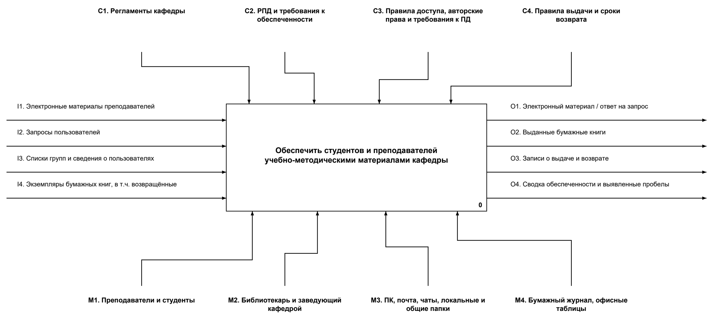
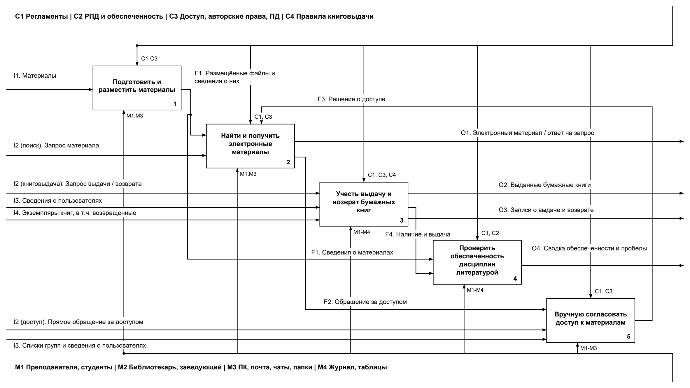
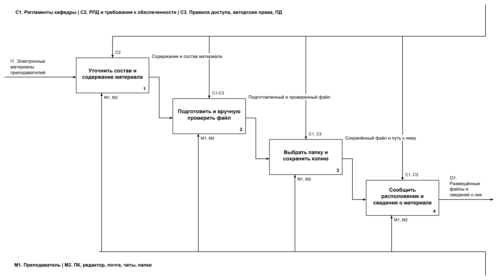
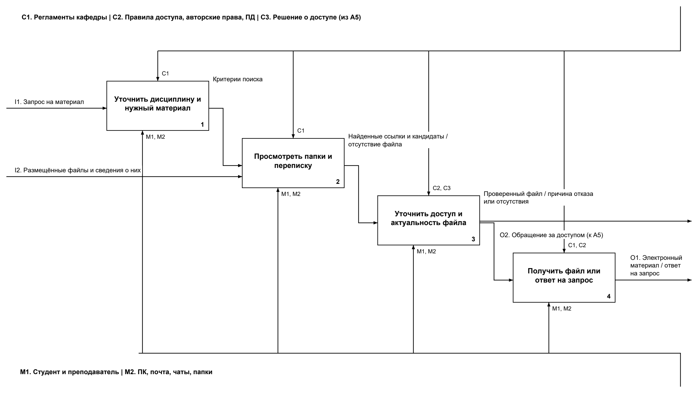
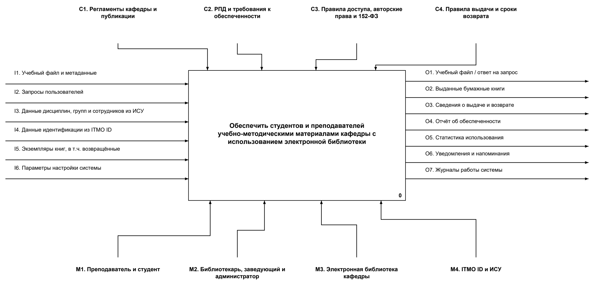
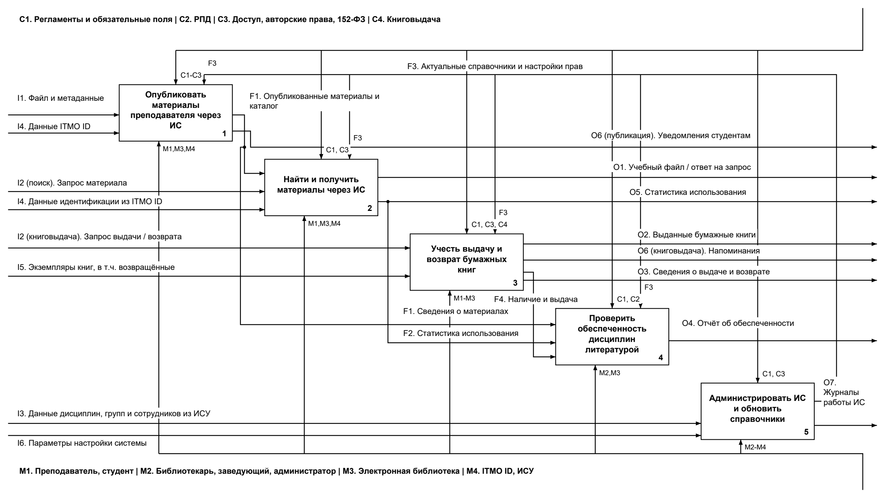
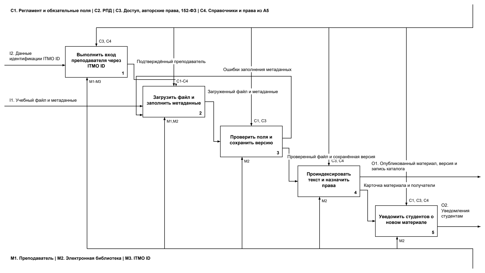
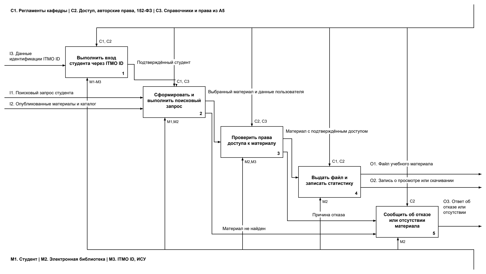

# Лабораторная работа № 3

## Разработка модели бизнес-процессов с учётом внедрения информационной системы

**Дисциплина:** Проектирование информационных систем.  
**Вариант № 6:** Электронная библиотека кафедры.  
**Выполнили:** Северюхин Андрей (AS-IS), Кохан Всеволод (TO-BE).

## 1. Цель работы

Спроектировать бизнес-процессы кафедры до и после внедрения ИС «Электронная библиотека кафедры» и определить последствия её внедрения.

Модель основана на концепции из лабораторной работы № 2. Объект автоматизации - условная кафедра ИТМО. Подробные ручные действия в AS-IS приняты как допущения учебной модели. Рассматриваются электронные материалы, выдача бумажных книг, доступ и обеспеченность литературой. Закупка и оцифровка книг в границы модели не входят.

Все диаграммы выполнены в IDEF0: входы входят слева, управления сверху, выходы выходят справа, механизмы входят снизу. A-0 содержит один блок 0; A0 раскрывает его на A1-A5; листы A1 и A2 показывают второй уровень. Коды I, C, O и M относятся к своему листу, а содержание граничных связей сохраняется при детализации.

## 2. Процессы до внедрения ИС (AS-IS)

### 2.1. Нулевой уровень A-0

**Функция:** обеспечить студентов и преподавателей учебно-методическими материалами кафедры.

| Тип | Содержание |
| --- | --- |
| Входы (I) | I1 - электронные материалы преподавателей; I2 - запросы на поиск, доступ, выдачу и возврат; I3 - списки групп и сведения о пользователях; I4 - экземпляры бумажных книг, включая возвращённые |
| Управления (C) | C1 - регламенты кафедры; C2 - РПД и требования к обеспеченности; C3 - правила доступа, авторские права и требования к персональным данным; C4 - правила выдачи и сроки возврата |
| Выходы (O) | O1 - электронный материал или ответ на запрос; O2 - выданные бумажные книги; O3 - записи о выдаче и возврате; O4 - сводка обеспеченности и выявленные пробелы |
| Механизмы (M) | M1 - преподаватели и студенты; M2 - библиотекарь и заведующий кафедрой; M3 - ПК, почта, мессенджеры и папки; M4 - бумажный журнал и офисные таблицы |

*Рисунок 1. Нулевой уровень AS-IS, A-0.*

**Пояснение.** Материалы передаются через почту, чаты и папки преподавателей. Люди вручную предоставляют доступ, учитывают книги и проверяют обеспеченность по РПД. Новая библиотечная ИС ещё не используется. Выданная книга и запись о выдаче показаны разными выходами.

### 2.2. Первый уровень A0

| Код | Функция | Результат |
| --- | --- | --- |
| A1 | Подготовить и разместить материалы | Файлы и сведения об их расположении |
| A2 | Найти и получить электронные материалы | Файл или ответ на запрос; обращение за доступом |
| A3 | Учесть выдачу и возврат бумажных книг | Выданные книги, записи в журнале и сведения о наличии |
| A4 | Проверить обеспеченность дисциплин литературой | Сводка обеспеченности и выявленные пробелы |
| A5 | Вручную согласовать доступ к материалам | Решение о разрешении или отказе |

*Рисунок 2. Первый уровень AS-IS, A0.*

**Пояснение.** A1 передаёт файлы в A2, а сведения о материалах в A4 (F1). При необходимости A2 направляет обращение в A5 (F2) и получает решение как управление (F3). A3 передаёт A4 сведения о наличии и выдаче книг (F4). Сверка с РПД выполняется вручную; общей статистики просмотров и скачиваний нет. Общие правила и механизмы объединены в пучки, состав которых указан у ветвей.

### 2.3. Второй уровень: декомпозиция A1

| Код | Функция |
| --- | --- |
| A11 | Уточнить состав и содержание материала |
| A12 | Подготовить и вручную проверить файл |
| A13 | Выбрать папку и сохранить копию |
| A14 | Сообщить расположение и сведения о материале |

*Рисунок 3. Подготовка и размещение материалов AS-IS, A1.*

**Пояснение.** Преподаватель готовит файл с учётом РПД, проверяет содержание и возможность распространения, сохраняет копию и сообщает её расположение. Входом остаются материалы преподавателя, выходом - размещённые файлы и сведения о них, то есть F1 на A0. Работу выполняет преподаватель с помощью ПК, редактора, почты и папок. Единого каталога и автоматического управления версиями нет.

### 2.4. Второй уровень: декомпозиция A2

| Код | Функция |
| --- | --- |
| A21 | Уточнить дисциплину и нужный материал |
| A22 | Просмотреть папки и переписку |
| A23 | Уточнить доступ и актуальность файла |
| A24 | Получить файл или ответ на запрос |

*Рисунок 4. Поиск и получение материалов AS-IS, A2.*

**Пояснение.** Студент ищет материал в доступных папках и переписке, при необходимости уточняет версию и доступ у преподавателя. A23 передаёт обращение в A5, а решение A5 поступает обратно как управление. Результатом становится файл либо ответ об отказе или отсутствии. Ручное уточнение не гарантирует получение последней версии; статистика использования не собирается.

## 3. Процессы после внедрения ИС (TO-BE)

### 3.1. Нулевой уровень A-0

**Функция:** обеспечить студентов и преподавателей учебно-методическими материалами кафедры с использованием электронной библиотеки.

| Тип | Содержание |
| --- | --- |
| Входы (I) | I1 - учебный файл и метаданные; I2 - запросы пользователей на поиск и книговыдачу; I3 - данные дисциплин, групп и сотрудников из ИСУ; I4 - данные идентификации из ITMO ID; I5 - экземпляры книг, включая возвращённые; I6 - параметры настройки системы |
| Управления (C) | C1 - регламенты кафедры и публикации, включая требования к обязательным полям; C2 - РПД и требования к обеспеченности; C3 - правила доступа, авторские права и требования 152-ФЗ; C4 - правила выдачи и сроки возврата |
| Выходы (O) | O1 - текущий учебный файл или ответ на запрос; O2 - выданные бумажные книги; O3 - сведения о выдаче и возврате; O4 - отчёт об обеспеченности; O5 - статистика использования; O6 - уведомления и напоминания; O7 - журналы работы системы |
| Механизмы (M) | M1 - преподаватель и студент; M2 - библиотекарь, заведующий кафедрой и администратор; M3 - электронная библиотека кафедры; M4 - ITMO ID и ИСУ |

*Рисунок 5. Нулевой уровень TO-BE, A-0.*

**Пояснение.** Основное изменение - появление ИС и внешних систем ITMO ID и ИСУ как механизмов. Входные данные становятся более формализованными, справочники обновляются централизованно, отчёты и статистика формируются системой. Физическая выдача книг сохраняется.

В рассматриваемый сценарий включены уведомления, хотя в концепции они имеют приоритет Could. Интеграции требуют согласования с ИТ-службой: данные из ИСУ только читаются, резервный вариант - импорт CSV-выгрузок. Под данными ITMO ID понимается подтверждение личности пользователя при входе.

### 3.2. Первый уровень A0

| Код | Функция | Содержание |
| --- | --- | --- |
| A1 | Публикация материалов преподавателем через ИС | Загрузка файла и метаданных, проверка полей, сохранение версии, запись в каталог и уведомление студентов |
| A2 | Поиск и получение материалов студентом через ИС | Поиск по каталогу и тексту, проверка прав по группе, выдача файла и регистрация просмотра или скачивания |
| A3 | Учёт и выдача бумажных книг | Электронная запись выдачи и возврата, срок возврата и напоминания; книгу передаёт библиотекарь |
| A4 | Контроль обеспеченности дисциплин литературой | Сопоставление литературы из РПД с фондом и формирование отчёта |
| A5 | Администрирование системы и синхронизация справочников | Настройка ИС и прав, обновление данных из ИСУ, ведение журналов работы |

*Рисунок 6. Первый уровень TO-BE, A0.*

**Пояснение.** A1 передаёт опубликованные материалы в A2 и сведения о них в A4 (F1). A5 предоставляет функциям A1-A4 актуальные справочники и настройки прав (F3). A3 передаёт A4 сведения о наличии и выдаче книг (F4). Статистика из A2 (F2) дополняет анализ востребованности, но обеспеченность определяется по РПД и наличию литературы. Почти все операции проходят через ИС; содержательные решения и физическая выдача остаются у людей.

Ручное управление доступом существовало и в AS-IS. В TO-BE оно перераспределяется между серверной проверкой в A2 и настройками A5; дополнительно появляются обслуживание ИС и синхронизация справочников.

### 3.3. Второй уровень: декомпозиция A1

| Код | Функция | Результат |
| --- | --- | --- |
| A11 | Вход преподавателя через ITMO ID | Подтверждённая учётная запись преподавателя |
| A12 | Загрузка файла и заполнение метаданных | Файл и карточка: название, дисциплина, тип, год |
| A13 | Проверка обязательных полей и сохранение версии | Ошибки для исправления или проверенный файл с новой версией |
| A14 | Индексация текста и назначение прав доступа | Опубликованный материал, версия и запись каталога |
| A15 | Уведомление студентов о новом материале | Сообщения студентам соответствующих групп |

*Рисунок 7. Публикация материалов TO-BE, A1.*

**Пояснение.** Преподаватель входит через ITMO ID, загружает файл и заполняет карточку. A13 сначала проверяет обязательные поля. При ошибке сведения возвращаются в A12; при успешной проверке сохраняется новая версия, а предыдущая уходит в архив и скрывается от студентов. Затем ИС индексирует текст, назначает доступ группам по данным ИСУ и отправляет уведомления. Опубликованный материал соответствует F1 на A0, уведомления входят в O6. Преподаватель отвечает за содержание и основание публикации; проверки и обработку выполняет ИС.

### 3.4. Второй уровень: декомпозиция A2

| Код | Функция | Результат |
| --- | --- | --- |
| A21 | Вход студента через ITMO ID | Подтверждённая учётная запись студента |
| A22 | Формирование и выполнение поискового запроса | Выбранный материал или результат «материал не найден» |
| A23 | Проверка прав доступа студента к материалу | Материал с подтверждённым доступом или причина отказа |
| A24 | Выдача файла и фиксация статистики | Файл и запись о просмотре или скачивании |
| A25 | Отображение сообщения об отказе или отсутствии материала | Ответ пользователю |

*Рисунок 8. Поиск и получение материалов TO-BE, A2.*

**Пояснение.** Студент входит через ITMO ID и использует каталог или полнотекстовый поиск. Система проверяет на сервере принадлежность к группе, изучающей дисциплину. Если доступ разрешён, A24 выдаёт файл и фиксирует событие использования. При отказе или отсутствии материала A25 выводит сообщение. Файл и ответ входят в O1 контекста, события использования в O5. Проверка прав и сбор статистики выполняются автоматически.

## 4. Основные различия до и после внедрения ИС

| Аспект | AS-IS | TO-BE | Ожидаемое последствие |
| --- | --- | --- | --- |
| Хранение | Почта, мессенджеры и личные папки | Единое хранилище и каталог | Проще найти место хранения материала |
| Поиск | Вручную, по папкам и переписке | Каталог и полнотекстовый поиск | Сокращение времени поиска |
| Версии | Актуальность уточняется вручную | Автоматическое версионирование | В ИС доступна текущая опубликованная версия |
| Доступ | Ручное согласование и пересылка | Проверка прав по группам ИСУ | Меньше ручных обращений и риска ошибочной выдачи |
| Бумажные книги | Бумажный журнал | Электронный учёт и напоминания | Проще контролировать возврат и задолженность |
| Обеспеченность | Ручная сверка с РПД | Сверка средствами ИС и отчёт | Меньше рутинной работы, актуальные сведения для заведующего |
| Статистика | Общая статистика отсутствует | Учёт просмотров и скачиваний | Можно оценивать востребованность материалов |
| Роль человека | Почти все операции выполняются вручную | Люди готовят содержание, принимают решения и выдают книги; ИС выполняет обработку и учёт | Снижение рутинной нагрузки; появляется обслуживание ИС |

В лабораторной № 2 исходное время поиска оценено примерно в 10 минут, целевое составляет не более 2 минут. Это планируемый эффект, который проверяется замерами после внедрения. Контроль версий и доступа действует внутри ИС и не исключает использование старых или пересланных копий вне неё.

## 5. Выводы

Построены восемь диаграмм IDEF0: нулевой и первый уровни, а также декомпозиции A1 и A2 для состояний AS-IS и TO-BE. Для каждого состояния на первом уровне выделено пять функций.

ИС переносит в систему каталогизацию, проверку прав, версионирование, индексацию, уведомления, учёт книг и статистики. Дополнительно появляется администрирование и синхронизация с ИСУ. Предусмотрены средства для снижения проблем П1-П7 из прошлой работы; фактический эффект зависит от качества данных и проверяется в эксплуатации. Ответственность за содержание, авторские права и управленческие решения остаётся у участников.

**Основание:** задание № 3 и [концепция ИС из лабораторной № 2](https://github.com/bropleaseletmein/pris/blob/4b23b9010381a751853972ec53955b9f790e20a7/lab2/lab2.md), разделы 1, 5 и 6.4.
